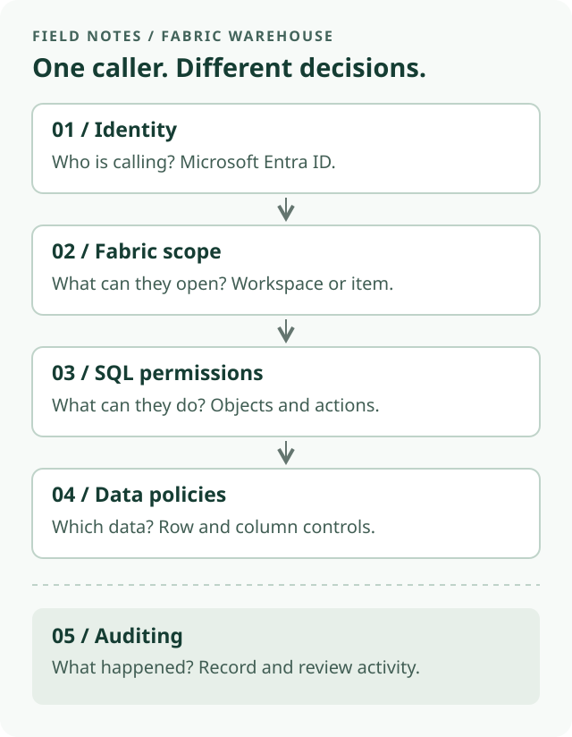
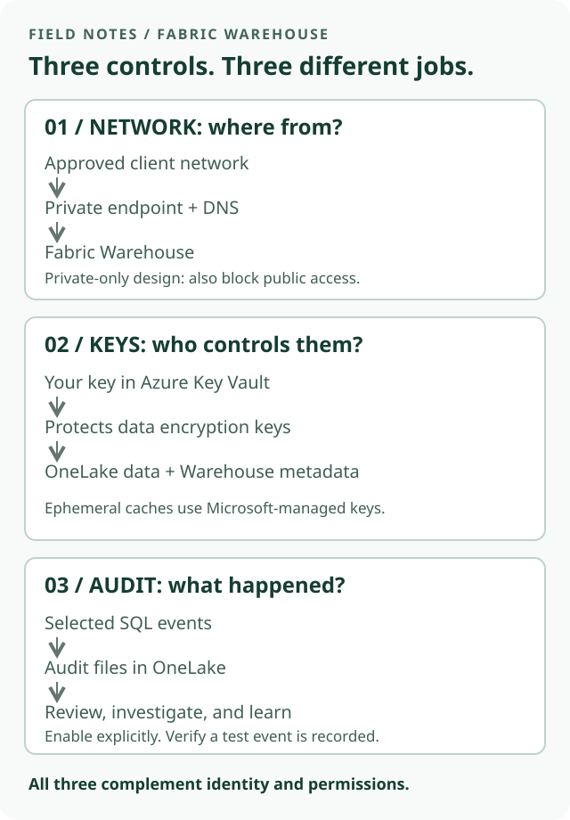

Giving someone access to a warehouse sounds like one decision. In Microsoft Fabric, it is several: **who is connecting, what they can open, and which data they can use**.

This first note in **Data Warehousing on Fabric** starts with identity and permissions, then adds network protection, encryption keys, and auditing. The aim is a practical introduction, not a complete security architecture.

> Start with least privilege: give people the smallest access scope and the fewest permissions that let them do their job.

## Before granting access, ask six questions

A short discovery conversation helps avoid permissions that are difficult to undo later:

1. **Who needs access?** A person, a team, or an application?
2. **How will they connect?** Through SQL, a report, or another data-access path?
3. **What can they do?** Read a report, query a view, load data, or administer the warehouse?
4. **Which data can they see?** Everything, one department, or only selected columns?
5. **Who manages security?** Separate permission administration from routine consumption where practical.
6. **How will access be checked?** Decide how to test permissions, review membership, and audit activity.

Also record network restrictions, ingestion identities, and encryption-key responsibilities. The sections below introduce the network, encryption, and audit decisions without turning this into a deployment walkthrough.

## Think in layers, not one permission

*A simplified SQL-access model. Auditing observes activity; it is not another permission gate.*

**Microsoft Entra ID** provides the identity. Prefer Entra security groups for team access rather than maintaining a long list of individual grants. Use a dedicated application identity for automation where supported, not a shared employee account.

**Fabric permissions** control access to a workspace or an individual Warehouse item. **SQL permissions** then define allowed operations on database objects. Row-level and column-level security provide additional controls when users should not see the same data.

These are connected controls, not interchangeable ones.

## Workspace roles are broader than they look

Workspace roles apply across the workspace, not just to the warehouse someone asked to use.

| Workspace role | Warehouse implication |
| --- | --- |
| Admin, Member, Contributor | Each receives `CONTROL` on warehouses in the workspace, including broad read/write and SQL permission-management capabilities. Their workspace-management capabilities differ. |
| Viewer | Receives connection and `ReadData` access to warehouses in the workspace. It is not a connection-only role. |

Use the first three roles for people who genuinely build or administer the solution. **Do not give an analyst Contributor merely to fix a query-access error.**

Viewer can be appropriate for workspace-wide readers, but it is a broad starting point if someone needs only one view in one warehouse. SQL restrictions can still apply to readers; a high-privilege builder who can manage permissions is not the right identity for validating those restrictions.

## Share one warehouse when that is all someone needs

Item permissions let you share a Warehouse without adding the person to the workspace.

The important distinction in the sharing dialog is:

- **Read:** permits connection to the SQL endpoint. On its own, it does not grant permission to query tables or views.
- **ReadData:** “Read all data using SQL.” This grants broad read access through SQL, subject to applicable SQL security restrictions.
- **ReadAll:** file access through OneLake/Spark. This is separate from SQL read access.

For a restricted SQL reader, start with **item Read**, then grant access to the required SQL objects. Do not select ReadData or ReadAll out of habit.

**Monitor** and **Audit** serve operational and auditing responsibilities, not ordinary report reading. Avoid bundling those responsibilities into every consumer's access.

> SQL policies protect the SQL query path. Do not assume they also protect direct file access through another engine. Review every access path before granting ReadAll.

## A small example: one team, one view

Suppose a fictional finance team needs a curated sales summary, not the underlying customer details.

1. Create an Entra security group for the intended readers.
2. Review its members' existing workspace roles, group memberships, and item permissions. A narrow grant does not remove access they already have.
3. Share only the Warehouse with that group, granting **Read** without the broad SQL or Spark read options.
4. Use SQL permissions, preferably managed through a purpose-specific database role, to grant access to the curated view.
5. Test using a representative reader identity: the approved view should work, and unrelated tables should not.

A view is useful for presenting a limited interface, but it is not a substitute for checking underlying permissions. If readers need different records, consider **row-level security (RLS)**. If particular fields must be restricted, consider **column-level security (CLS)**.

Keep the first implementation small: one group, one clearly defined requirement, and explicit allow-and-deny checks. Add more rules only when the requirement calls for them.

## Protect the network path

Permissions answer **who may use the data**. Network controls answer **where connections may come from**. You need both.

Fabric supports **Private Link** at tenant and workspace scope. It lets supported client connections reach Fabric through private endpoints rather than the public internet. For a private-only design, configure the corresponding public-access restriction too: **creating a private endpoint alone does not mean public access is blocked**.

Keep the first design conversation simple:

- Choose tenant-wide protection or a boundary around specific workspaces.
- Plan private DNS and connectivity for the people and tools that need access.
- Test the Fabric portal, SQL clients, ingestion jobs, and downstream integrations before restricting public access.
- Confirm that an approved private client connects and a client outside the allowed network cannot.

Private Link controls **inbound** access. It does not automatically secure Fabric's outbound connections to source systems. Plan that path separately using the networking options supported by the actual workload and connector.

Feature support and connection details differ by scope. For example, workspace-level Warehouse connectivity has specific hostname requirements. Follow the setup documentation rather than assuming an existing connection string and DNS configuration will work unchanged.

> A private connection does not grant SQL access. A valid identity still needs the right Fabric and SQL permissions.

## Know what customer-managed keys protect

Fabric Warehouse data is **encrypted at rest by default using Microsoft-managed keys**. Customer-managed keys (CMK) add control over the key lifecycle; they are not required to switch encryption on.

With workspace CMK, an organization manages a key in **Azure Key Vault**. Fabric uses envelope encryption: the customer-managed key protects data encryption keys, which protect the stored data.

For Warehouse, distinguish three areas:

| Area | What to know |
| --- | --- |
| OneLake data | Persisted data is encrypted; workspace CMK adds customer control over the keys protecting it. |
| Warehouse metadata | CMK also protects metadata such as table definitions, functions, and stored procedures. |
| Backend compute caches | Caches are ephemeral and use Microsoft-managed encryption, not CMK. Fabric clears them after use. |

Do not assume every saved query surface is covered: Microsoft's Warehouse documentation currently lists portal query editor Object Explorer queries as outside CMK encryption.

**Keep key administration separate from routine data access where practical.** Enable Key Vault soft delete and purge protection, document key ownership, and plan rotation and recovery before enabling CMK. Verify supported workspace items and current prerequisites.

An inaccessible or revoked key can interrupt warehouse reads and writes. Treat a rotation or revocation as an operational change with a recovery plan, not just a security checkbox. CMK does not replace permissions, row filters, or private connectivity.

*Different jobs: network controls constrain the route, keys protect stored content, and audit records help explain activity. None replaces authorization.*

## Audit what happened

SQL audit logs help answer **who did what, when, and in which context**. Depending on the configured events, they can record database authentication attempts, object and permission changes, and query activity.

**SQL auditing is off by default.** An authorized user must enable it and choose what to capture. Warehouse SQL audit files are stored as `.XEL` files in the Warehouse's Audit folder in OneLake; authorized users can inspect them or query them with supported SQL tooling.

A small, useful starting process:

1. Define the question to answer: for example, who changed a permission or queried a sensitive object?
2. Enable the relevant audit action groups or actions in the Warehouse audit settings.
3. Perform a harmless test action and verify the resulting event, identity, timestamp, and available context.
4. Assign an owner to review findings and define retention, access, and storage-cost expectations.

Do not treat all security evidence as one log:

| Question | Evidence to consult |
| --- | --- |
| What database query or SQL permission change occurred? | Warehouse SQL audit logs, with the relevant events enabled. |
| What happened during Entra sign-in or MFA evaluation? | Microsoft Entra sign-in logs. SQL authentication events are not the complete identity-provider record. |
| Who performed a Fabric item or workspace activity? | Fabric activity auditing through Microsoft Purview, for supported operations. |

Correlate identity and timestamps across sources; use session or other correlation fields where available. Do not assume every log includes the same fields.

Audit records support investigation, incident timelines, compliance evidence, and operational learning. **They do not automatically block an action or guarantee complete evidence.** Microsoft notes that under very high activity or network load, transactions may proceed without every configured event being recorded.

Restrict access to the logs themselves: query text and context may be sensitive. Avoid indiscriminate collection or filters that silently exclude the very events an investigation would need.

## Check the whole setup

Before calling the setup complete:

- Test both an allowed query and a query that must fail, using a reader rather than an administrator.
- Check direct grants, inherited group access, workspace roles, and alternate data paths.
- Allow for permission propagation and reconnect before troubleshooting a recent change.
- Test the intended private route and the blocked public route, if private-only access is required.
- Check CMK coverage, key access, and the recovery plan before changing keys.
- Configure SQL auditing for the activity you need to record; verify that events are captured and access to logs is appropriately restricted.
- Review access when people change roles or leave the team.

The useful mental model is simple: **identity identifies the caller; permissions and data policies limit access; networking constrains the route; encryption protects stored content; auditing helps explain what happened.**

Start there before adding more advanced controls.

## Sources and next steps

This note targets **Warehouse in Microsoft Fabric**, not Fabric SQL database or every Lakehouse access mode. It is a conceptual guide, not a tenant-tested configuration walkthrough. Product permissions can evolve; check the current documentation before applying changes.

Official Microsoft Learn references, checked October 27, 2026:

- [Secure your Fabric Data Warehouse](https://learn.microsoft.com/en-us/fabric/data-warehouse/security)
- [Workspace roles in Fabric Data Warehouse](https://learn.microsoft.com/en-us/fabric/data-warehouse/workspace-roles)
- [Share your data and manage permissions](https://learn.microsoft.com/en-us/fabric/data-warehouse/share-warehouse-manage-permissions)
- [SQL granular permissions](https://learn.microsoft.com/en-us/fabric/data-warehouse/sql-granular-permissions)
- [Microsoft Entra authentication](https://learn.microsoft.com/en-us/fabric/data-warehouse/entra-id-authentication)
- [Row-level security](https://learn.microsoft.com/en-us/fabric/data-warehouse/row-level-security)
- [Configure SQL audit logs](https://learn.microsoft.com/en-us/fabric/data-warehouse/configure-sql-audit-logs)
- [Private links for Fabric tenants](https://learn.microsoft.com/en-us/fabric/security/security-private-links-overview)
- [Workspace-level private links](https://learn.microsoft.com/en-us/fabric/security/security-workspace-level-private-links-overview)
- [Data encryption in Fabric Data Warehouse](https://learn.microsoft.com/en-us/fabric/data-warehouse/encryption)
- [Customer-managed keys for Fabric workspaces](https://learn.microsoft.com/en-us/fabric/security/workspace-customer-managed-keys)
- [SQL audit logs: events, permissions, and limitations](https://learn.microsoft.com/en-us/fabric/data-warehouse/sql-audit-logs)
- [Track user activities in Microsoft Fabric](https://learn.microsoft.com/en-us/fabric/admin/track-user-activities)

A useful follow-up would be a hands-on example of granting a group access to one view and testing the result.
